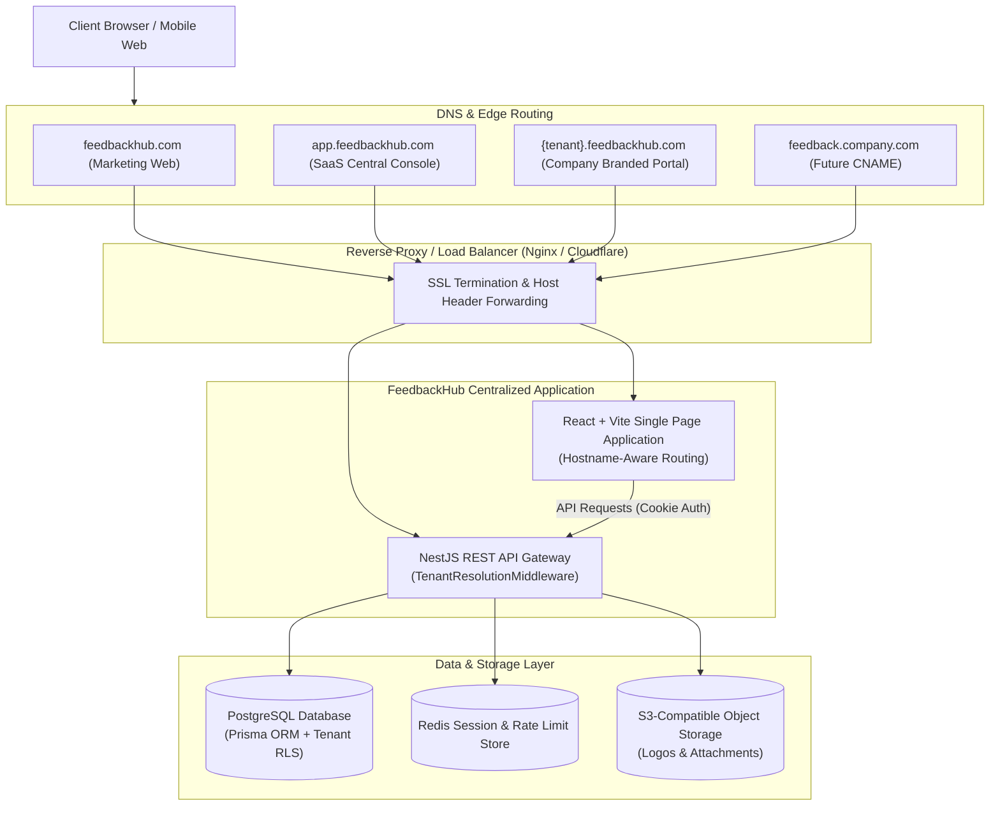
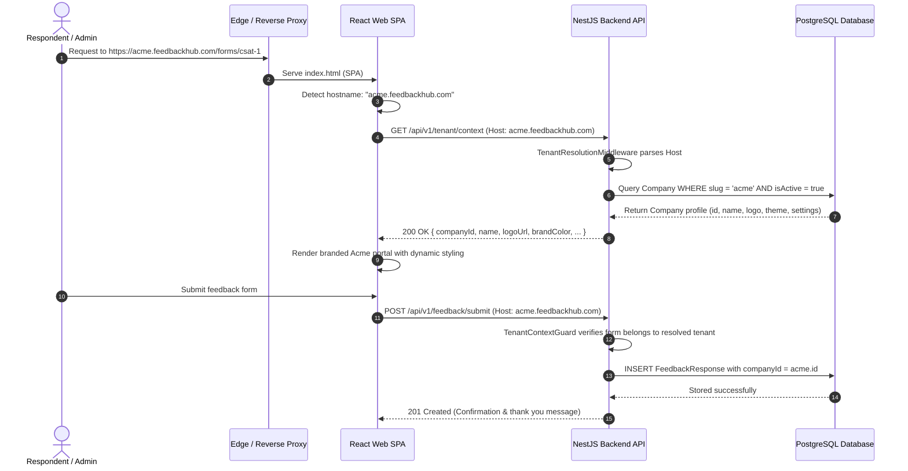

# FeedbackHub — System Architecture & Technical Design

**Document Version:** 1.0.0  
**Status:** Approved Foundation  
**Architecture Pattern:** Monorepo Centralized Multi-Tenant SaaS with Hostname-Based Dynamic Routing  

---

## 1. High-Level Architectural Vision

FeedbackHub is engineered as a **centralized multi-tenant SaaS application** rather than a multi-instance or siloed deployment. A single shared application runtime and database infrastructure serves all tenants, while strictly isolating each tenant's data, brand assets, user sessions, and operational workflows.



---

## 2. Monorepo Structure & Package Boundaries

FeedbackHub uses a clean **pnpm workspace monorepo** architecture to enforce code reuse, strict dependency boundaries, and unified tooling.

```
feedbackhub/
├── apps/
│   ├── web/                  # Unified React + Vite + Tailwind CSS SPA
│   └── api/                  # NestJS TypeScript REST API
├── packages/
│   ├── ui/                   # Shared design system components (shadcn/ui + Radix + Tailwind)
│   ├── types/                # Shared TypeScript models, DTOs, and API contracts
│   ├── validation/           # Shared Zod validation schemas (isomorphic frontend & backend)
│   └── config/               # Shared ESLint, Prettier, and TypeScript configurations
├── database/
│   ├── prisma/               # Prisma schema definitions, migrations, and seeds
│   ├── migrations/           # Versioned SQL migration files
│   └── seed/                 # Development and test seed scripts
├── docs/                     # Core architectural, security, and product documentation
├── .env.example              # Canonical environment variable manifest
├── docker-compose.yml        # Local development infrastructure (Postgres, Redis, MinIO)
├── package.json              # Monorepo root scripts and dev tooling
└── pnpm-workspace.yaml       # Workspace package definitions
```

### 2.1 Workspace Responsibilities
- **`apps/web`**: Single frontend entry point handling all three operational modes (Marketing site, Authenticated SaaS workspace, and Branded public/employee feedback portal) using hostname-aware router matching.
- **`apps/api`**: NestJS backend providing modular REST endpoints, Swagger documentation, tenant resolution, session management, and RBAC guards.
- **`packages/types`**: Type definitions shared between frontend and backend to guarantee end-to-end contract consistency.
- **`packages/validation`**: Isomorphic Zod validation schemas used for client-side form validation and server-side DTO validation pipes.
- **`packages/ui`**: Component library adhering to the FeedbackHub design system.
- **`database`**: Central database management, Prisma schema definitions, and migration workflows.

---

## 3. Hostname-Based Tenant Resolution Pipeline

A cornerstone of FeedbackHub is that **the client never specifies a `companyId` in the body or URL path as an authoritative claim of identity**. The tenant context is resolved securely from the incoming HTTP `Host` header.



### 3.1 Hostname Resolution Logic
1. **Base Domain Matching**: The backend checks against the configured `APP_BASE_DOMAIN` (e.g., `feedbackhub.com` in production, `localhost` in local dev).
2. **Subdomain Extraction**:
   - `feedbackhub.com` or `www.feedbackhub.com` -> **Marketing Portal Context**
   - `app.feedbackhub.com` -> **Central SaaS Application / Workspace Context**
   - `{slug}.feedbackhub.com` -> **Tenant Portal Context** (Tenant slug = `{slug}`)
   - Unknown or custom host (e.g., `feedback.customer.com`) -> Lookup custom domain registry in `Company` table.
3. **Reserved Slugs Protection**: System reserves critical slugs that cannot be claimed by tenants: `app`, `api`, `admin`, `www`, `docs`, `auth`, `status`, `billing`, `mail`, `webhook`, `static`.
4. **Tenant Context Binding**: Once resolved, the tenant context is attached to the NestJS request object (`req.tenant`) for downstream consumption by guards, interceptors, and repositories.

---

## 4. Frontend Architecture (`apps/web`)

The frontend is a single, performant React Single Page Application (SPA) built with Vite, TypeScript, Tailwind CSS, and TanStack Query.

### 4.1 Hostname-Aware Routing
The client entry point detects the browser `window.location.hostname` on load:
- **Root Mode (`feedbackhub.com`)**: Routes to Marketing landing pages, pricing, contact, and public documentation.
- **App Mode (`app.feedbackhub.com`)**: Routes to SaaS authentication, onboarding, company management, form builder, response viewer, and settings dashboards.
- **Tenant Mode (`{slug}.feedbackhub.com`)**: Routes to the tenant's branded public catalog, specific customer feedback forms, and employee survey entry points.

### 4.2 State & Data Management
- **Server State**: Managed via `@tanstack/react-query` with caching, optimistic updates, and background refetching.
- **Form State**: Managed via `react-hook-form` paired with `@hookform/resolvers/zod` for zero-runtime validation discrepancies.
- **Theme Injection**: CSS Variables (`--primary`, `--accent`, `--radius`) are injected into the DOM root based on the resolved company brand configuration.

---

## 5. Backend Architecture (`apps/api`)

The backend is built with NestJS, organizing business logic into cohesive, maintainable modules.

```
apps/api/src/
├── common/
│   ├── decorators/         # @CurrentTenant(), @CurrentUser(), @Roles()
│   ├── filters/            # Global HttpExceptionFilter, PrismaExceptionFilter
│   ├── guards/             # SessionAuthGuard, TenantContextGuard, RolesGuard
│   ├── interceptors/       # LoggingInterceptor, TenantAuditInterceptor
│   └── middleware/         # HostnameTenantResolverMiddleware, SecurityHeadersMiddleware
├── config/                 # Typed environment configuration via @nestjs/config + Zod
├── modules/
│   ├── auth/               # Password hashing, session lifecycle, login/logout
│   ├── tenant/             # Tenant lookup, branding, settings, domain verification
│   ├── user/               # User profiles, platform super admin, invitations
│   ├── form/               # Form builder, question management, branching logic
│   ├── response/           # Public & authenticated submission ingestion, answers
│   ├── analytics/          # Aggregation, NPS calculation, trend analysis
│   ├── subscription/       # Tier limits, quotas, billing webhooks (stubbed)
│   └── audit/              # Immutable audit logging service
└── main.ts                 # Bootstrap with helmet, CORS, cookies, validation pipes
```

### 5.1 Defense-in-Depth Tenant Isolation
Every database query in a tenant context is bound by:
1. **Tenant Middleware**: Resolves tenant from hostname and sets `req.tenant`.
2. **Tenant Guard**: Validates that the active session or requested public resource belongs strictly to `req.tenant.id`.
3. **Prisma Scoping**: All service-layer repositories explicitly inject `companyId: req.tenant.id` into `where` clauses.
4. **PostgreSQL RLS (Row-Level Security)**: Database-level session variables (`SET LOCAL app.current_tenant_id = '...'`) enforce row-level constraints as a fail-safe backstop.

---

## 6. Authentication, Sessions & Security

### 6.1 Session Management
- **Mechanism**: Server-side session storage backed by PostgreSQL / Redis with an opaque, cryptographically random session ID.
- **Cookie Security**: Delivered via `Set-Cookie` with:
  - `HttpOnly: true` (inaccessible to JavaScript, immunizing against XSS session theft)
  - `Secure: true` (transmitted only over HTTPS)
  - `SameSite: Lax` (mitigates Cross-Site Request Forgery while allowing standard top-level navigation)
  - `Path: /`
  - Cookie domain scoped appropriately for cross-subdomain authentication where necessary.

### 6.2 Password Security
- Passwords hashed using **Argon2id** (memory cost 64MB, time cost 3, parallelism 1) or **bcrypt** (12 rounds) with individual salts.

---

## 7. Storage & Third-Party Integration Strategy

### 7.1 Object Storage (S3-Compatible)
- **Use Cases**: Company logos, branded banners, optional response file attachments.
- **Security**: Buckets are private by default. Public brand assets are served via a CDN reverse proxy. Sensitive attachments are delivered exclusively through time-limited signed URLs generated by the API after tenant permission checks.

### 7.2 Email Service (Resend)
- **Prepared Architecture**: Outbox table and event-driven email worker using `@nestjs/bullmq` or internal event bus.
- **Phase 1 Status**: Abstracted email provider interface with console/mock logging to ensure zero external network dependencies during development.

### 7.3 Payment Service (Razorpay)
- **Prepared Architecture**: Subscription entity tracks plan tier, quotas, renewal dates, and Razorpay customer/subscription IDs.
- **Phase 1 Status**: Billing operations disabled/stubbed; database schema models subscription states ready for Phase 12 activation.

---

## 8. Deployment, Scaling & Environment Strategy

### 8.1 Local Development Environment
- Orchestrated via `docker-compose.yml`:
  - PostgreSQL 16 (Relational database)
  - Redis 7 (Session cache and rate-limiting)
  - MinIO (Local S3-compatible object store)
- Local wildcard domain resolution configured via `127.0.0.1 feedbackhub.local`, `app.feedbackhub.local`, `acme.feedbackhub.local` in hosts file or dnsmasq.

### 8.2 Production Target Architecture
- Containerized Docker images deployed on modern cloud infrastructure (AWS ECS / GCP Cloud Run / Render / Fly.io / Kubernetes).
- Cloudflare Edge Proxy provides wildcard SSL (`*.feedbackhub.com`), DDoS mitigation, Web Application Firewall (WAF), and global CDN edge caching for static assets.
