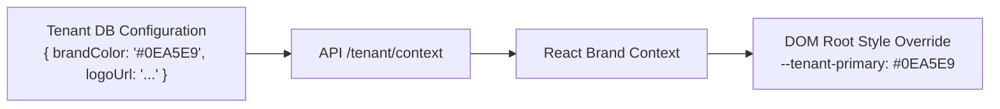

# FeedbackHub — Design System & Visual Identity

**Document Version:** 1.0.0  
**Status:** Approved Foundation  
**Design Philosophy:** Premium Modern SaaS with Friendly, High-Conversion UX  
**Inspiration:** Clean, refined visual aesthetic inspired by modern, high-polish interfaces (soft depth, pill controls, subtle gradients, generous breathing room)  

---

## 1. Core Visual Principles

FeedbackHub is designed around two distinct emotional experiences unified under one cohesive design system:
1. **Respondent Forms (Customer & Employee)**: Friendly, conversational, frictionless, and human. The respondent should feel valued and confident in submitting feedback.
2. **Company Workspace & Dashboards**: Professional, refined, high-information-density, and calm. Data visualizations and operational controls should feel clear and effortless.

### Core Tenets
- **Generous Whitespace**: High visual breathing room to reduce cognitive overload.
- **Soft Shadows & Subtle Borders**: Subtle border strokes (`border-slate-100` / `border-slate-200/80`) paired with multi-layer ambient drop shadows.
- **Selective Gradients**: Tasteful, subtle gradients on hero highlights, active states, and primary CTAs—avoiding overwhelming neon or visual noise.
- **Micro-Delight**: Fluid micro-interactions and transitions with full accessibility support for `prefers-reduced-motion`.

---

## 2. Color Palette & Token Architecture

The color system is constructed using CSS Custom Properties and Tailwind CSS utility mappings.

### 2.1 Primary & Semantic Color Tokens

```css
:root {
  /* Brand Spectrum */
  --primary: #8B5CF6;         /* Primary Purple: Main brand accent, key actions */
  --secondary: #EC4899;       /* Secondary Pink: Highlights, delight moments, NPS promoters */
  --sky-blue: #38BDF8;        /* Sky Blue: Informational accents, active tabs, pulse surveys */
  --teal: #2DD4BF;            /* Teal: Positive states, resolved feedback, CSAT 5-star */

  /* Neutral Surface Spectrum */
  --background: #FAFAFC;      /* App Canvas Background: Soft clean cool white */
  --card: #FFFFFF;            /* Surface Card Background: Crisp pure white */
  --card-elevated: #FFFFFF;   /* Elevated Modals / Dropdowns */
  
  /* Text & Typography Hierarchy */
  --text-primary: #1E293B;    /* Slate 800: High-contrast headings and body text */
  --text-secondary: #64748B;  /* Slate 500: Subtitles, helper text, timestamps */
  --text-muted: #94A3B8;      /* Slate 400: Placeholders, disabled states */

  /* Borders & Dividers */
  --border: #F1F5F9;          /* Slate 100: Standard container borders */
  --border-focus: #8B5CF6;    /* Purple: Focus rings and selected inputs */

  /* Functional Status */
  --success: #10B981;         /* Emerald 500: Success notifications */
  --warning: #F59E0B;         /* Amber 500: Warnings, passive NPS */
  --danger: #EF4444;          /* Red 500: Errors, destructive actions, detractor NPS */
}
```

---

## 3. Strict Rounded UI Rules

All UI components must adhere strictly to these defined corner radius rules to preserve a distinctive, modern look and feel across the product:

| UI Component | Corner Radius Rule | Tailwind Class | Usage Guidelines |
| :--- | :--- | :--- | :--- |
| **Main Dashboard Cards** | `20px` | `rounded-[20px]` | Primary metrics cards, analytics containers, chart wrappers. |
| **Small Cards & Widgets** | `16px` | `rounded-2xl` | Form selector cards, mini stat widgets, survey question cards. |
| **Primary Buttons** | Pill-shaped (`9999px`) | `rounded-full` | Primary CTAs (e.g., "Submit Feedback", "Create New Form"). |
| **Secondary Buttons** | `12px` | `rounded-xl` | Secondary actions, table row actions, toolbar buttons. |
| **Input Fields & Textareas**| `12–14px` | `rounded-xl` | Form inputs, select dropdowns, search bars, textarea fields. |
| **Modal Windows & Dialogs** | `24px` | `rounded-3xl` | Dialog popups, form preview modal, confirmation sheets. |
| **Badges & Status Tags** | Pill-shaped (`9999px`) | `rounded-full` | Status indicators (`New`, `Resolved`), category chips, tags. |
| **Avatars** | Circular (`9999px`) | `rounded-full` | User profile avatars, company logos in circular frames. |

---

## 4. Typography Scale

FeedbackHub uses a clean, modern sans-serif typography stack based on **Inter** with tabular figure support for numerical analytics.

```css
font-family: 'Inter', -apple-system, BlinkMacSystemFont, 'Segoe UI', Roboto, sans-serif;
```

| Token | Size | Weight | Line Height | Usage |
| :--- | :--- | :--- | :--- | :--- |
| `display-1` | 36px (2.25rem) | 700 (Bold) | 1.2 | Landing page hero, big metric displays |
| `h1` | 28px (1.75rem) | 700 (Bold) | 1.25 | Dashboard page headers, form titles |
| `h2` | 22px (1.375rem) | 600 (Semibold) | 1.3 | Card headers, section dividers |
| `h3` | 18px (1.125rem) | 600 (Semibold) | 1.4 | Question headings, modal titles |
| `body-base`| 15px (0.9375rem)| 400 (Regular) | 1.5 | Standard body text, form answers |
| `body-sm`  | 13px (0.8125rem)| 500 (Medium) | 1.4 | Table data, form descriptions, badges |
| `caption`  | 11px (0.6875rem)| 500 (Medium) | 1.3 | Timestamps, helper text, footnote metadata |

---

## 5. Elevation, Shadows & Depth

To achieve an organic, modern surface depth without harsh shadows:

```css
/* Tailwind custom shadow extensions */
box-shadow: {
  'soft-sm': '0 2px 8px -2px rgba(15, 23, 42, 0.04), 0 1px 4px -1px rgba(15, 23, 42, 0.02)',
  'soft-md': '0 8px 24px -4px rgba(15, 23, 42, 0.06), 0 2px 8px -2px rgba(15, 23, 42, 0.03)',
  'soft-lg': '0 20px 40px -8px rgba(15, 23, 42, 0.08), 0 4px 12px -2px rgba(15, 23, 42, 0.04)',
  'glow-purple': '0 0 24px -4px rgba(139, 92, 246, 0.25)',
}
```

---

## 6. Dynamic Tenant Branding & White-Labeling

When serving a tenant portal (`{company}.feedbackhub.com`), the application dynamically themes the UI using CSS custom property overrides:



### Contrast & Accessibility Safeguard
To guarantee WCAG 2.1 AA compliance:
- Tenant-provided brand colors are validated for contrast against light backgrounds (`#FFFFFF` and `#FAFAFC`).
- If a brand color has insufficient contrast ratio ($< 4.5:1$), the system automatically computes a shade adjustment for text and focus rings while preserving the original hue on decorative accents.

---

## 7. Motion & Animation Guidelines

FeedbackHub incorporates Framer Motion for purposeful, non-distracting motion:
- **Duration**: Fast, responsive interactions (150ms – 250ms).
- **Easing**: Smooth cubic bezier (`[0.16, 1, 0.3, 1]`).
- **Reduced Motion**: All animations wrap within `@media (prefers-reduced-motion: reduce)` to disable transitions for sensitive users.
- **Form Transition**: Questions transition using subtle horizontal slide and opacity fade, providing a conversational step-by-step experience.
