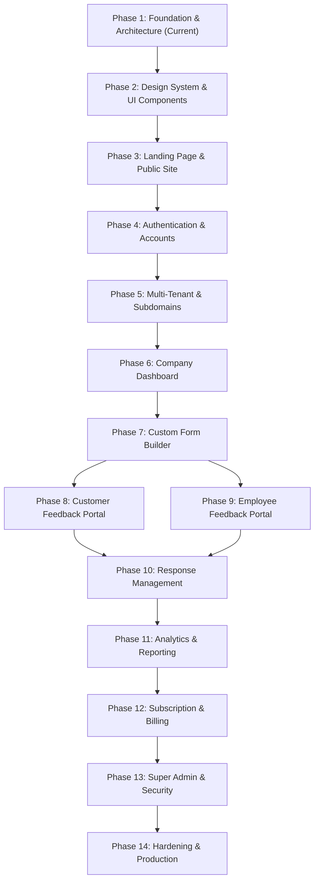

# FeedbackHub — 14-Phase Product & Engineering Roadmap

**Document Version:** 1.0.0  
**Status:** Approved Foundation  
**Execution Strategy:** Strict incremental delivery across 14 discrete phases  

---

## Roadmap Overview

---

## Detailed Phase Breakdown

### Phase 1 — Product Foundation and Architecture *(Current Assignment)*
- **Primary Goal**: Establish core architecture documentation, repository monorepo structure, initial conceptual database design, and verification tooling.
- **Key Deliverables**:
  - Comprehensive documentation suite: `PRD.md`, `ARCHITECTURE.md`, `DATABASE.md`, `SECURITY.md`, `DESIGN_SYSTEM.md`, `ROADMAP.md`.
  - pnpm workspace monorepo configuration with clean package boundaries (`apps/web`, `apps/api`, `packages/*`, `database`).
  - Git repository initialization and baseline verification.
  - Environment variable manifests and Docker Compose definition.
- **Verification Criteria**: Workspace packages resolve; lint/TypeScript configurations validate; no committed secrets.

---

### Phase 2 — Design System and UI Foundation
- **Primary Goal**: Build and catalog the reusable component library matching the FeedbackHub aesthetic.
- **Key Deliverables**:
  - Tailwind CSS custom configuration with exact brand colors and radius rules.
  - Core UI primitives in `packages/ui` (Pill Buttons, Rounded Cards, Inputs, Modals, Badges, Tabs, Empty States).
  - Storybook / Component showcase or visual preview for all states (default, hover, focus, disabled, loading).
- **Verification Criteria**: All components pass accessibility (contrast, ARIA, keyboard navigation) and adhere to the strict rounded radius specs.

---

### Phase 3 — Landing Page and Public Website
- **Primary Goal**: Deliver a marketing presence on `feedbackhub.com`.
- **Key Deliverables**:
  - Responsive marketing landing page with hero, product features, dual audience explanation (Customer vs Employee), live interactive demo widget, and pricing grid.
  - Hostname routing distinction between marketing domain and SaaS application.
  - SEO metadata, OpenGraph tags, and mobile responsive layout.
- **Verification Criteria**: Fast load performance (<1.5s LCP), zero layout shift, seamless navigation to sign-up / login.

---

### Phase 4 — Authentication and Account Management
- **Primary Goal**: Implement secure server-side session authentication and profile management.
- **Key Deliverables**:
  - NestJS authentication module with Argon2id password hashing and session management.
  - Secure, HttpOnly, SameSite=Lax cookie issuance and validation.
  - User registration, login, logout, password reset flow, and email verification stubs.
  - Protected route wrappers in React with active user context.
- **Verification Criteria**: Automated unit and integration tests for authentication flows; immunity against session hijacking and brute force attacks.

---

### Phase 5 — Multi-Tenant SaaS and Company Subdomains
- **Primary Goal**: Implement company onboarding and dynamic subdomain resolution.
- **Key Deliverables**:
  - Company creation workflow with unique slug reservation and reserved name protection.
  - Hostname tenant resolution middleware in NestJS and React router integration.
  - Dynamic company branding engine (custom logo, brand colors, favicon).
  - RBAC membership initialization (Company Owner role assignment).
- **Verification Criteria**: Navigating to `{company}.feedbackhub.local` loads the company's branded portal; cross-tenant data requests are strictly blocked.

---

### Phase 6 — Company Dashboard
- **Primary Goal**: Build the authenticated management workspace for company staff.
- **Key Deliverables**:
  - Company dashboard layout (navigation sidebar, header, tenant switcher, user profile).
  - Overview metrics cards (total responses, active forms, customer vs employee response split).
  - Quick action shortcuts and recent activity feed.
  - Team member invitation and role assignment interface (Owner, Admin, Manager).
- **Verification Criteria**: Dashboard loads cleanly with loading skeletons, handles zero-data empty states gracefully, and enforces RBAC permissions.

---

### Phase 7 — Custom Feedback Form Builder
- **Primary Goal**: Provide a visual, drag-and-drop form authoring environment.
- **Key Deliverables**:
  - Interactive form editor supporting question creation, reordering, deletion, and preview.
  - Supported question types: NPS (0-10), CSAT (1-5 stars/emojis), Multiple Choice, Single Choice, Short/Long Text, Likert Scale.
  - Configuration settings: Audience selector (Customer vs Employee), Anonymity rules (Anonymous Only, Identified Only, Respondent Choice).
  - Form publishing, sharing links, and embed code generation.
- **Verification Criteria**: Form schemas validate with Zod; changes persist reliably to the database with undo/redo capabilities.

---

### Phase 8 — Customer Feedback Portal
- **Primary Goal**: Deliver frictionless public feedback submission for customers.
- **Key Deliverables**:
  - Public branded form page at `{company}.feedbackhub.com/f/{form-slug}`.
  - Conversational, mobile-first responsive submission experience.
  - Real-time client-side validation using shared Zod schemas.
  - Anti-spam rate limiting and submission receipt confirmation.
- **Verification Criteria**: High-speed submission under varied network conditions; immediate response confirmation.

---

### Phase 9 — Employee Feedback Portal
- **Primary Goal**: Build an internal survey experience with guaranteed anonymity.
- **Key Deliverables**:
  - Internal portal at `{company}.feedbackhub.com/internal`.
  - Strict anonymous mode with zero IP / zero User-Agent tracking.
  - Employee pulse surveys and anonymous suggestion box.
  - Respondent privacy notices detailing exact cryptographic guarantees.
- **Verification Criteria**: Independent security test verifying that database records for anonymous responses contain no personally identifiable data.

---

### Phase 10 — Response Management
- **Primary Goal**: Enable teams to triage, filter, and act on received feedback.
- **Key Deliverables**:
  - Response inbox with multi-attribute filtering (form, audience, date range, rating, status).
  - Detailed response view with internal notes, status update workflow (New, In Review, In Progress, Resolved).
  - Assignment to team managers and CSV/JSON export capabilities with RBAC checks.
- **Verification Criteria**: Fast search and pagination across 10,000+ responses; internal notes strictly isolated from public views.

---

### Phase 11 — Analytics and Reporting
- **Primary Goal**: Transform raw submissions into actionable business intelligence.
- **Key Deliverables**:
  - NPS calculation engine (Promoters, Passives, Detractors) with trend tracking.
  - CSAT score distribution and rating breakdowns.
  - Departmental segmentation with privacy floor enforcement ($k \ge 5$ responses).
  - Exportable executive summary reports (PDF / CSV).
- **Verification Criteria**: Aggregation queries execute in <300ms; small cohort responses are mathematically masked to protect employee anonymity.

---

### Phase 12 — Subscription and Billing
- **Primary Goal**: Monetize the platform with self-service subscription plans.
- **Key Deliverables**:
  - Tiered plan definitions (Starter Free, Pro, Enterprise) with feature gates and quota limits.
  - Razorpay checkout integration and subscription lifecycle webhook handling.
  - In-app billing management portal (invoices, upgrade/downgrade, cancelation).
- **Verification Criteria**: Webhook signature verification succeeds; plan limits immediately reflect in application permissions.

---

### Phase 13 — Super Admin and Security
- **Primary Goal**: Provide centralized governance, auditability, and administrative oversight.
- **Key Deliverables**:
  - Platform Super Admin console at `admin.feedbackhub.com`.
  - Tenant directory, global metrics, health monitoring, and tenant suspension controls.
  - Immutable platform audit log viewer with search and export.
  - Security hardening (CSP headers, rate limit tuning, vulnerability scans).
- **Verification Criteria**: Super admin actions are strictly logged; tenant data cannot be inspected without explicit elevated break-glass logging.

---

### Phase 14 — Testing and Production Deployment
- **Primary Goal**: Validate reliability, security, and performance for production launch.
- **Key Deliverables**:
  - End-to-end test suite using Playwright covering critical user journeys.
  - Backend integration test suite covering tenant isolation and RLS policies.
  - Docker production container builds with multi-stage minimization.
  - Production deployment pipeline, health check endpoints, and backup runbooks.
- **Verification Criteria**: 100% passing test suites; zero high-severity security vulnerabilities; automated deployment readiness.
