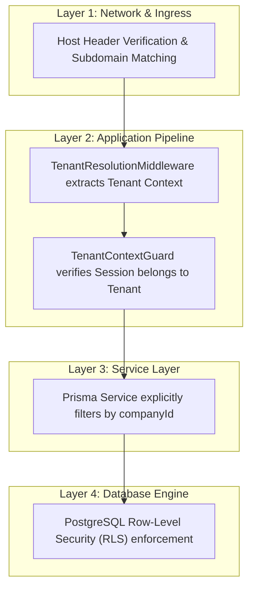

# FeedbackHub — Security Architecture & Threat Model

**Document Version:** 1.0.0  
**Status:** Approved Foundation  
**Classification:** Security Architecture & Policy  

---

## 1. Security Philosophy & Defense-in-Depth

Security is a foundational pillar of FeedbackHub. The platform adopts a **Zero-Trust, Defense-in-Depth** model:
1. **Never trust client-supplied tenant identifiers**: Tenant resolution is derived strictly from verified hostnames or cryptographically signed session tokens.
2. **Explicit authorization at every layer**: Edge -> API Gateway -> NestJS Route Guards -> Service Layer -> Database RLS.
3. **Privacy by design**: Anonymous submissions are structurally and cryptographically decoupled from respondent identities.
4. **Assume compromise**: Minimal privilege principle applied to all service accounts, database users, and human roles.

---

## 2. Multi-Tenant Isolation Enforcement

Multi-tenancy leaks represent the single highest severity risk in B2B SaaS. FeedbackHub implements four distinct layers of tenant isolation:

1. **Ingress Filtering**: Rejects requests with malformed Host headers or spoofed tenant claims.
2. **Middleware & Guard Binding**: Every authenticated API route requires `TenantContextGuard`, which matches the session's active `companyId` with the resolved tenant.
3. **Repository Scoping**: Every Prisma query explicitly includes `companyId` in the `where` clause.
4. **PostgreSQL Row-Level Security**: The PostgreSQL connection executes with `SET LOCAL app.current_tenant_id = '...'` to prevent queries from breaching tenant partitions even if application logic fails.

---

## 3. Role-Based Access Control (RBAC) Matrix

FeedbackHub enforces a strict hierarchical RBAC model across tenant and platform scopes:

| Permission Area | Platform Super Admin | Company Owner | Company Admin | Company Manager | Public / Respondent |
| :--- | :---: | :---: | :---: | :---: | :---: |
| **System-wide Metrics** | Full Access | No | No | No | No |
| **Tenant Settings & Domain** | Override Only | Full Access | Read / Edit (Limited) | No | No |
| **Subscription & Billing** | Manage | Full Access | View Only | No | No |
| **User & Team Management** | Manage | Full Access | Invite / Manage | No | No |
| **Form Builder (Create/Edit)** | No (Privacy) | Full Access | Full Access | View / Assigned Forms | No |
| **Form Publishing / Deletion** | No | Full Access | Full Access | No | No |
| **View Customer Responses** | No (Privacy) | Full Access | Full Access | Assigned Only | No |
| **View Employee Responses** | No (Privacy) | Full Access* | Full Access* | Assigned Only* | No |
| **Submit Feedback** | No | Yes | Yes | Yes | Full Access (Public) |
| **Audit Logs Inspection** | Platform Scope | Full Access | Tenant Scope | No | No |

*\*Subject to the minimum respondent privacy threshold ($k \ge 5$) on segmented departmental reports.*

---

## 4. Authentication & Session Management

### 4.1 Credential Protection
- Passwords hashed using **Argon2id** (memory: 64MB, iterations: 3, parallelism: 1) with per-user cryptographically secure random salts.
- Minimum password policy: 10 characters, requiring uppercase, lowercase, numbers, and symbols.
- Rate limiting on login attempts (5 failed attempts per 15-minute window per IP/email) to prevent brute-force credential stuffing.

### 4.2 Session Architecture
- **Token Mechanism**: Cryptographically secure, high-entropy 256-bit random session identifiers stored server-side in PostgreSQL / Redis.
- **Cookie Security Configuration**:
  - `HttpOnly: true` (Prevents client-side XSS access)
  - `Secure: true` (Ensures transmission strictly over TLS/HTTPS)
  - `SameSite: Lax` (Defends against Cross-Site Request Forgery while preserving standard link navigation)
  - `Domain: .feedbackhub.com` (Allows seamless session delegation across authorized subdomains)
  - `Max-Age: 604800` (7 days sliding expiration with absolute 30-day cap)

---

## 5. Anonymous Feedback Privacy Principles

Anonymous feedback must never be compromised. The system adheres to these privacy specifications:

### 5.1 Anti-Fingerprinting Measures
1. **Zero IP Address Storage**: Neither IPv4 nor IPv6 addresses are written to the database for anonymous form submissions.
2. **Stripped User-Agent**: Browser User-Agent headers, screen resolutions, and hardware fingerprints are discarded prior to database persistence.
3. **Timing Jitter**: Anonymous submission timestamps are truncated or rounded to minute intervals to defeat correlation attacks against web server access logs.
4. **Decoupled Tokens**: Submission tokens provided to respondents use non-sequential UUIDv4/nanoid keys with zero mathematical relation to user identities or submission order.

### 5.2 Small Team Privacy Safeguard ($k$-Anonymity)
When managers view employee survey analytics:
- Any demographic segment (e.g., "Engineering > Backend > Junior Developers") containing fewer than **5 responses** has its granular data suppressed.
- The UI displays an alert: *"Data suppressed to protect respondent anonymity (minimum 5 responses required)"*.

---

## 6. Protection Against Common Web Vulnerabilities

| Vulnerability | Threat | FeedbackHub Countermeasure |
| :--- | :--- | :--- |
| **SQL Injection** | Unauthorized query execution | Strict use of Prisma ORM parameterized queries; raw SQL is prohibited in application code. |
| **Cross-Site Scripting (XSS)** | Malicious script execution in browser | React automatic context-aware HTML escaping; DOMPurify on markdown fields; strict Content-Security-Policy (CSP) headers. |
| **Cross-Site Request Forgery (CSRF)** | Unauthorized state-changing actions | SameSite cookie attributes; custom `X-Requested-With` or CSRF token validation on mutation endpoints. |
| **SSRF (Server-Side Request Forgery)** | Internal network probing via webhooks | Webhook endpoints validate target URLs against RFC 1918 private IP blocks and DNS rebinding protections. |
| **Denial of Service (DoS)** | Brute force or resource exhaustion | Global and per-route rate limiting via `@nestjs/throttler` backed by Redis. Public form submission endpoints are throttled to 20 requests per minute per IP. |
| **Clickjacking** | UI redressing in malicious iframes | `X-Frame-Options: SAMEORIGIN` and CSP `frame-ancestors 'self'`. |

---

## 7. Audit Logging & Security Observability

All security-sensitive operations generate immutable audit log records:
- **Captured Events**: Authentication success/failure, role modifications, tenant settings changes, form publishing/unpublishing, response exports, and data deletion.
- **Log Immutability**: The `AuditLog` table has no `UPDATE` or `DELETE` API endpoints. In production, logs are streamed to append-only cloud storage (AWS CloudWatch / GCP Cloud Logging).
- **No Sensitive Data in Logs**: Passwords, raw tokens, and anonymous respondent inputs are strictly sanitized and excluded from log payloads.

---

## 8. Secrets Management & Operational Security

- **Environment Separation**: All credentials, database connection strings, and encryption keys are injected exclusively via environment variables (`process.env`).
- **No Committed Secrets**: `.env` and `.env.local` are enforced in `.gitignore`. CI/CD pipelines run automated secret scanning (e.g., Gitleaks / TruffleHog).
- **Object Storage Access**: Tenant assets stored in private S3-compatible buckets. Public assets (logos) are served via CDN; private response attachments require short-lived (15-minute) pre-signed URLs generated following tenant authorization verification.
- **Database Backup & Recovery**: Automated daily snapshots with 30-day point-in-time recovery (PITR) and cross-region encrypted backup storage.
