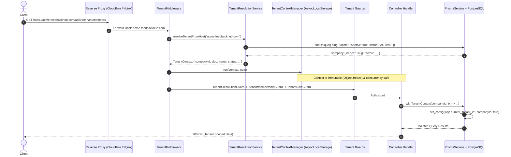

# FeedbackHub — Multi-Tenant System Architecture & Implementation Guide

**Document Version:** 1.0.0  
**Phase:** Phase 5 — Multi-Tenant Foundation  
**Status:** Implemented & Verified  

---

## 1. Overview & Tenancy Strategy

FeedbackHub operates as a **centralized multi-tenant SaaS application** with strict multi-layer tenant isolation. A single shared application runtime and database infrastructure serves all companies (tenants) while guaranteeing that:
1. Every tenant's data, members, invitations, settings, and future feedback forms/responses are completely partitioned.
2. Tenant identification and membership are verified cryptographically and authorization-checked on every request.
3. No user can access or mutate tenant data merely by supplying a tenant ID or company slug in a client payload.
4. Database-level protections (PostgreSQL Row-Level Security) act as an immutable fail-safe backstop behind application-level controls.

---

## 2. Hostname Resolution & Classification

FeedbackHub classifies every incoming HTTP request by hostname before it reaches controllers.

### 2.1 Domain Classification Matrix

| Hostname Pattern | Type | Target Resource | Tenant Scoped? |
| :--- | :--- | :--- | :--- |
| `feedbackhub.com`, `www.feedbackhub.com` | `MARKETING` | Public landing page, pricing, blogs | No |
| `localhost:3000`, `localhost:4000` | `MARKETING` | Local marketing site / base API | No |
| `app.feedbackhub.com` | `APP` | Central SaaS application / account hub | No |
| `app.localhost:3000` | `APP` | Local central SaaS application | No |
| `admin.feedbackhub.com`, `ops.feedbackhub.com` | `PLATFORM` | System administration portal | No |
| `{slug}.feedbackhub.com` | `TENANT` | Company-specific branded workspace | **Yes** |
| `{slug}.localhost:3000` | `TENANT` | Local development tenant workspace | **Yes** |
| `feedback.acmecorp.com` (Custom Domain) | `TENANT` | CNAME-mapped branded workspace | **Yes** |

### 2.2 Localhost Development Workflow (`.localhost`)

Per **RFC 6761 Section 6.3**, all `.localhost` domains loop back to `127.0.0.1` by standard DNS resolvers without requiring `/etc/hosts` or Windows `hosts` file modification:
- `http://acme.localhost:3000` resolves to the `acme` tenant in local development.
- `http://app.localhost:3000` resolves to the central application console.
- `http://localhost:3000` resolves to the marketing website.

Port numbers (e.g. `:3000`, `:4000`) are automatically stripped during hostname extraction before database lookup.

### 2.3 Reverse-Proxy & Host Spoofing Security (`TRUSTED_PROXY`)

In production environments behind reverse proxies (Nginx, Cloudflare, AWS ALB), clients may attempt to spoof hostnames via `X-Forwarded-Host` or `Host` headers.

`TenantResolutionService` enforces secure host extraction:
```typescript
// If TRUSTED_PROXY=true (or 1), trust the leftmost client-facing host in X-Forwarded-Host.
// If TRUSTED_PROXY is false/absent, ignore X-Forwarded-Host and read req.headers.host only.
```
- Multi-valued `X-Forwarded-Host` headers (comma-delimited) are parsed strictly by extracting the first (client-supplied) hop.
- All extracted hosts are lowercased and stripped of port numbers.
- Subdomain slugs are validated against regex `^[a-z0-9]+(-[a-z0-9]+)*$` before database execution.
- If a resolved company is inactive (`isActive: false` or `status !== 'ACTIVE'`), resolution fails closed with `404 Not Found`.

---

## 3. Request-Scoped Context Lifecycle (`AsyncLocalStorage`)

Tenant context is managed through Node.js native `AsyncLocalStorage` via `TenantContextManager`.



### 3.1 Context Immutability & Concurrency Safety
- Context objects are frozen via `Object.freeze()` before being bound to `AsyncLocalStorage`.
- Nested asynchronous microtasks, promise chains, and concurrent HTTP requests preserve discrete isolated contexts with zero cross-request contamination.
- The `@CurrentTenant()` decorator accesses `TenantContextManager.getOrThrow()` or `req.tenant` cleanly.

---

## 4. Authorization & Guard Hierarchy

Tenant routes are protected by a three-tiered defense-in-depth guard pipeline:

```
[ SessionAuthGuard ] -> [ TenantResolutionGuard ] -> [ TenantMembershipGuard ] -> [ TenantRoleGuard ]
```

### 4.1 Guard Responsibilities
1. **`SessionAuthGuard`**: Authenticates user identity via secure server-side session cookie. Rejects unauthenticated requests with `401 Unauthorized`.
2. **`TenantResolutionGuard`**: Validates that the request has successfully resolved to an active tenant. Fails closed with `404 Not Found` if accessed on a non-tenant domain.
3. **`TenantMembershipGuard`**: Queries the user's membership for the resolved `companyId`. Requires `status === 'ACTIVE'`. Rejects inactive, suspended, or non-members with `403 Forbidden`.
4. **`TenantRoleGuard`**: Reads `@RequireRoles(...)` metadata and verifies the user's role against the required hierarchy.

### 4.2 Role Hierarchy

FeedbackHub enforces a strict three-tier role hierarchy:

$$\text{OWNER (Weight 3)} > \text{ADMIN (Weight 2)} > \text{MANAGER (Weight 1)}$$

- **OWNER**: Highest authority. Full configuration, billing, member management, invitation issuance, and company deletion. Cannot be demoted or removed; ownership can only be transferred atomically. Exactly one OWNER per company.
- **ADMIN**: Operations, template management, team invites, manager role modifications. Cannot modify, demote, or suspend the OWNER or other ADMINs.
- **MANAGER**: Read and operational interaction with assigned feedback workflows. Cannot modify members, change company settings, or invite users.

---

## 5. Membership Lifecycle & Security Controls

All membership mutations are encapsulated within `TenantMembershipService` and executed inside transactional boundaries.

### 5.1 Owner Protection Rules
- **No Self-Demotion**: An OWNER cannot demote their own role to ADMIN or MANAGER.
- **No Self-Suspension**: An OWNER cannot suspend their own status.
- **No Removal**: An OWNER cannot be removed from the company. A company cannot be rendered ownerless.
- **Admin Privilege Isolation**: ADMINs cannot promote users to OWNER, nor can they alter or remove other ADMINs or the OWNER.

### 5.2 Atomic Ownership Transfer
Ownership transfer swaps roles between the current OWNER and an active member inside an atomic database transaction:
1. Validates that the caller is the current OWNER.
2. Validates that the target user is an `ACTIVE` member of the same company.
3. Demotes current OWNER to `ADMIN`.
4. Promotes target user to `OWNER`.
5. Emits an audit log event.

### 5.3 Member Removal & Data Integrity
- When a member is removed (`removeMember`), their `CompanyMembership` record is deleted.
- If the member had active pending invitations created, those invitations remain attributed for auditing or are managed by remaining admins.
- If the target is the OWNER, the operation is blocked with `403 Forbidden`.

---

## 6. Invitation Workflow & Token Security

Team member onboarding uses a cryptographically secure tokenized invitation pattern:

### 6.1 Invitation Issuance
1. Caller (`OWNER` or `ADMIN`) submits `{ email, role }`.
2. Normalized email (`lowercase`, trimmed) is checked against existing memberships:
   - If an active membership exists: `409 Conflict` (`"User is already a member of this company"`).
   - If a pending invitation already exists: `409 Conflict` (`"An active pending invitation already exists for this email"`).
3. A **32-byte cryptographically secure random token** is generated using `crypto.randomBytes(32).toString('hex')`.
4. The token is hashed with **SHA-256**:
   $$\text{tokenHash} = \text{SHA-256}(\text{rawToken})$$
5. The `CompanyInvitation` record stores `tokenHash`, `email`, `role`, `status = 'PENDING'`, and `expiresAt` (default: **7 days**).
6. **Zero Raw Token Persistence**: The plaintext `rawToken` is returned only once to the caller (for email delivery) and is never persisted in the database or written to logs.

### 6.2 Invitation Acceptance
1. Invitee submits `{ token }` to `/api/v1/tenant/invitations/accept` while authenticated.
2. Token is hashed: `tokenHash = SHA-256(token)`.
3. Database looks up the invitation by `tokenHash`:
   - If not found: `400 Bad Request` (`"Invalid or expired invitation token"`).
   - If status $\ne$ `'PENDING'`: `400 Bad Request`.
   - If `expiresAt < now()`: marks status as `'EXPIRED'` and rejects with `400 Bad Request`.
4. **Email Identity Enforcement**:
   - The authenticated user's email **must match** the invitation email.
   - If the user's email does not match: `403 Forbidden` (`"This invitation was sent to a different email address"`).
   - The authenticated user's account must be active (`status === 'ACTIVE'`).
5. In an atomic transaction:
   - Marks invitation as `'ACCEPTED'`.
   - Creates `CompanyMembership` with `{ companyId, userId, role, status: 'ACTIVE' }`.

### 6.3 Invitation Revocation
- An `OWNER` or `ADMIN` can revoke any pending invitation via `DELETE /api/v1/tenant/invitations/:id`.
- Revoked invitations transition to `status = 'REVOKED'` and cannot subsequently be accepted.

---

## 7. Database-Level Isolation: PostgreSQL Row-Level Security (RLS)

FeedbackHub enforces multi-layered tenant isolation:
1. **Application Layer**: NestJS middleware, guards, and services always scope queries by `companyId`.
2. **Database Layer**: PostgreSQL Row-Level Security policies prevent cross-tenant data leaks even if an application query omits `where: { companyId }`.

### 7.1 PostgreSQL Configuration & Force RLS
```sql
-- Force RLS ensures policies apply to table owners as well as standard connection roles
ALTER TABLE "CompanyMembership" ENABLE ROW LEVEL SECURITY;
ALTER TABLE "CompanyMembership" FORCE ROW LEVEL SECURITY;

ALTER TABLE "CompanyInvitation" ENABLE ROW LEVEL SECURITY;
ALTER TABLE "CompanyInvitation" FORCE ROW LEVEL SECURITY;

-- Tenant Isolation Policies
CREATE POLICY tenant_isolation_membership ON "CompanyMembership"
    FOR ALL
    USING (
        companyId = NULLIF(current_setting('app.current_tenant_id', true), '')::uuid
    );

CREATE POLICY tenant_isolation_invitation ON "CompanyInvitation"
    FOR ALL
    USING (
        companyId = NULLIF(current_setting('app.current_tenant_id', true), '')::uuid
    );
```

### 7.2 Connection Pooling Compatibility
In pooled database connection architectures (PgBouncer, AWS RDS Proxy), database sessions are shared across requests. Standard `SET` statements leak session state across connection checkouts.

FeedbackHub uses **transaction-local settings**:
```sql
SELECT set_config('app.current_tenant_id', '<company-uuid>', true);
```
- The third argument (`is_local = true`) guarantees that `app.current_tenant_id` is scoped strictly to the active database transaction.
- Upon `COMMIT` or `ROLLBACK`, the variable is immediately cleared, preventing state contamination across pooled connections.

### 7.3 `withTenantContext` Helper
The `PrismaService` exposes a type-safe transactional execution wrapper:
```typescript
await prisma.withTenantContext(companyId, async (tx) => {
  return tx.companyMembership.findMany();
});
```

---

## 8. Pattern for Adding Future Tenant-Scoped Models

When introducing new domain entities in Phase 6+ (e.g. `FeedbackForm`, `FeedbackResponse`, `FeedbackAnswer`, `Tag`):

1. **Schema Definition**:
   - Always include a non-nullable `companyId String @db.Uuid` field with an index.
   - Add foreign key relation to `Company` with `onDelete: Cascade`.
2. **Migration & RLS**:
   - Enable and force RLS in the migration:
     ```sql
     ALTER TABLE "FeedbackForm" ENABLE ROW LEVEL SECURITY;
     ALTER TABLE "FeedbackForm" FORCE ROW LEVEL SECURITY;
     CREATE POLICY tenant_isolation_feedback_form ON "FeedbackForm"
       FOR ALL USING (companyId = NULLIF(current_setting('app.current_tenant_id', true), '')::uuid);
     ```
3. **Service Layer**:
   - Inject `companyId` into all `where` and `data` clauses from `@CurrentTenant()`.
   - Wrap operations using `prisma.withTenantContext(companyId, ...)`.
